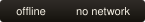
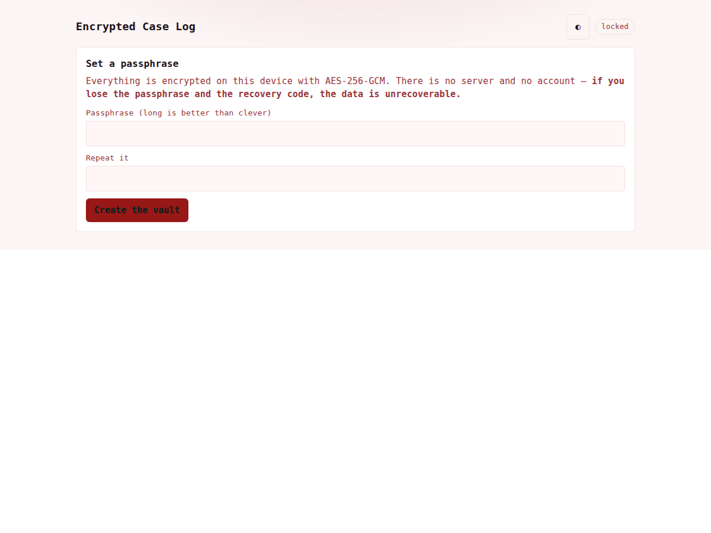

# Encrypted Case Log

[](https://drsamonline.github.io/app-encrypted-case-log/play/)




[](LICENSE)

**Per-patient clinical notes, encrypted on the device. Offline. No account, no server.**

Everything lives on the device, encrypted at rest with **AES-256-GCM** (Web Crypto), in
**IndexedDB**. The page carries `connect-src 'none'`, so an outbound request is impossible
even by accident — there is nothing to send your notes to.

| | |
|---|---|
| **Landing page** | https://drsamonline.github.io/app-encrypted-case-log/ |
| **Live app** | https://drsamonline.github.io/app-encrypted-case-log/play/ |
| **Demo vault** (sample records, memory only) | https://drsamonline.github.io/app-encrypted-case-log/play/index.html?demo=1 |
| **Source** | https://github.com/drsamonline/app-encrypted-case-log |
| **Changelog** | [CHANGELOG.md](CHANGELOG.md) |
| **All projects** | https://drsamonline.github.io/ |

<!-- shot:start -->



<!-- shot:end -->

The landing page embeds the real app in a frame, driven by guided buttons
(`#patients`, `#note`, `#search`, `#locked`) rather than four static pictures. Screens of
the app itself, at both widths, live in `docs/assets/app-desktop.png` and
`docs/assets/app-mobile.png`; both are produced by `scripts/shot.sh app`, the icon set by
`scripts/icons.py`, and the badges by `scripts/badges.py` — an offline-first app should not
fetch an image service to describe itself.

Built with Forge, composing five shared kits: `crypto-kit` (AES-GCM, PBKDF2, key wrap),
`case-kit` (the record shape), `search-kit` (ranked search), `export-kit` (save a file) and
`web-kit` (shell, storage runtime, PWA). The four language dictionaries are the app's own
strings and live in the app's script — app data, not a kit.

## Run it

`docs/play/index.html` is the whole app. No build step, no install.

```
node tests/self-tests.js      # 21 tests, no browser needed
python3 scripts/icons.py      # the PWA icon set, rendered locally
```

Append `?demo=1` to open the sample vault — real crypto over real records, but held in
memory, so nothing is written to your device.

## The vault, and what it means for you

- You set a **passphrase**. A key-encryption key is derived from it with
  **PBKDF2-HMAC-SHA256, 600,000 iterations, a random 16-byte salt**.
- A random **data-encryption key (DEK)** encrypts the records. The passphrase only
  **wraps** the DEK — so changing the passphrase never re-encrypts a record.
- A **verifier** (a known constant encrypted with the DEK) makes a wrong passphrase fail
  cleanly instead of silently producing garbage.
- A **24-word recovery code** wraps the same DEK, so a forgotten passphrase is survivable.
  It is shown **once**; rotating it invalidates the old one immediately.

> **Without the passphrase or the recovery code, the data is unrecoverable.** There is no
> server to reset it, and that is the point — not an oversight.

A header written with fewer KDF rounds than the current target is re-wrapped at the higher
count on its next unlock. That is the only place the passphrase exists, so it is the only
place an upgrade can happen.

## The records

One record per blob, a **fresh 96-bit IV every time**, and the record id as **AAD**, so a
record cannot be swapped or replayed. The self-tests prove that: a swapped record fails to
decrypt, no IV is ever reused, and the ciphertext never contains the plaintext.

A patient carries a **short label — initials or a code, not a full name**. The device may be
shared, and the label is the field most likely to be seen.

Each note carries a **severity from 1 to 4**, and the patient view draws that as a line —
inline SVG, no chart library. Deleting is a **tombstone** you can undo until you lock;
purging happens on lock. Every save keeps up to **five previous versions**, as the old
ciphertexts themselves, so a restore is a decrypt and never a rewrite of history.

## Search, and its ceiling

**You cannot search ciphertext.** On unlock the app decrypts every record into memory and
builds a transient index with `search-kit`; the index is thrown away on lock. A plaintext
index on disk would leak exactly what we encrypted, so there isn't one.

The index is built **once per data change**, not once per keystroke, and unlock decrypts in
**batches of 250** so a large vault paints early instead of blocking on one pass. Filters
for **tag** and a **date range** sit beside the search box.

**The honest ceiling is about 50,000 records** — the decrypt-everything-on-unlock step is
linear, and past that the unlock becomes slow on a phone. It is not unlimited, and the app
does not pretend it is.

## Export and import

- **`.ecl`** — a single encrypted archive (the vault header and every encrypted record). It is
  already encrypted, so it is safe to keep anywhere. The app prints a **SHA-256 of the
  archive** when it writes one, so a restore can be checked.
- **Plaintext CSV** — behind a clear warning, for when you must hand something over, and
  **CSV import** with a column preview for the reverse direction.
- **Import merges by default**: a dry-run count of *new / newer / identical* records, then a
  merge keyed on record id and timestamp. Replacing the vault is a second, explicit question.
- **Print** with a print stylesheet hands a single record over on paper — offline, no PDF
  library.
- A double-clicked `.ecl` opens the app through `file_handlers`, still with no network.

The round-trip is tested: **export → wipe → import → identical data.**

## Safety

Never persists the DEK; it is held in memory only and cleared on lock. **Auto-locks after 5
minutes idle** (configurable) and on demand, and can lock the moment the tab is hidden.
Requests `navigator.storage.persist()` so the database is not evicted, and shows the quota
it is using.

Optional, and off by default: **destroy the vault after N wrong passphrases**, for a device
you expect to be taken. A **decoy vault** is also available — a second passphrase opening a
separate, empty vault with its own key. Nothing marks it as a decoy, because a marker would
defeat it.

A **vault health** panel decrypts every record and reports anything that fails, and the
self-tests can be run from the page.

The service worker serves the **HTML network-first** (the cache is only the offline
fallback) and asks the registration to update on every load, so a shipped release is not
hidden behind a stale cache. The footer prints a **version and build stamp**, so "am I on
the new one?" is answerable from the page itself.

## Languages and keyboard

English, **हिन्दी, ગુજરાતી and मराठी** are bundled as local dictionaries inside the app's own
script — no translation service, no network. Anything without a translation falls back to
English rather than pretending.

`N` new patient · `/` search · `Ctrl`+`S` save · `L` lock · `S` settings · `Esc` close ·
`?` the list. Text size, and a **redaction curtain** for a shared screen, live in Settings.

## Layout

```
docs/index.html          the landing page — its own design, not the app's
docs/play/               the app: index.html plus the kits, sw.js, manifest
docs/play/icons/         the PWA icon set, generated by scripts/icons.py
docs/assets/             app screenshots and the generated badges
docs/shot.png            the pipeline's own screenshot (do not hand-edit)
scripts/badges.py        draws the badges into docs/assets/badge-*.svg
scripts/icons.py         renders the icon set from icon.svg / icon-maskable.svg
scripts/shot.sh          headless Chromium screenshots, desktop and phone widths
index.html, *.js         a mirror of docs/play/ kept at the repo root
```

## Licence

PolyForm Noncommercial — see `LICENSE`. © 2026 Dr Sohil Momin.
