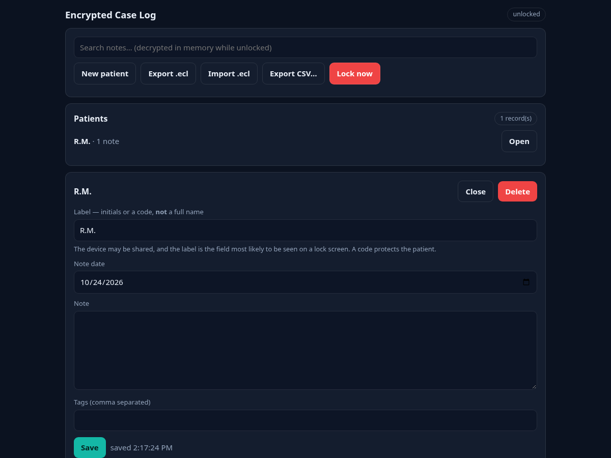

# Encrypted Case Log

<!-- shot:start -->



<!-- shot:end -->


<!-- badges:start -->
[](https://drsamonline.github.io/app-encrypted-case-log/)
[](https://drsamonline.github.io/)
[](https://drsamonline.github.io/app-encrypted-case-log/play/)
[](https://github.com/drsamonline/app-encrypted-case-log)

[](LICENSE)
[](https://github.com/drsamonline/app-encrypted-case-log)
[](https://github.com/drsamonline/app-encrypted-case-log)
[](https://github.com/drsamonline/app-encrypted-case-log/releases)
[](https://github.com/drsamonline/app-encrypted-case-log/commits/main)
<!-- badges:end -->


**Per-patient clinical notes, encrypted on the device. Offline. No account, no server.**

Everything lives on the device, encrypted at rest with **AES-256-GCM** (Web Crypto), in
**IndexedDB**. The page carries `connect-src 'none'`, so an outbound request is impossible
even by accident — there is nothing to send your notes to.

Built with Forge, composing five shared kits: `crypto-kit` (AES-GCM, PBKDF2, key wrap),
`case-kit` (the record shape), `search-kit` (ranked search), `export-kit` (save a file) and
`web-kit` (shell, storage runtime, PWA).

## Run it

Open `index.html` — that is the whole app. No build step, no install.

```
node tests/self-tests.js      # 15 tests, no browser needed
```

## The vault, and what it means for you

- You set a **passphrase**. A key-encryption key is derived from it with
  **PBKDF2-HMAC-SHA256, 600,000 iterations, a random 16-byte salt**.
- A random **data-encryption key (DEK)** encrypts the records. The passphrase only
  **wraps** the DEK — so changing the passphrase never re-encrypts a record.
- A **verifier** (a known constant encrypted with the DEK) makes a wrong passphrase fail
  cleanly instead of silently producing garbage.
- A **24-word recovery code** wraps the same DEK, so a forgotten passphrase is survivable.
  It is shown **once**.

> **Without the passphrase or the recovery code, the data is unrecoverable.** There is no
> server to reset it, and that is the point — not an oversight.

## The records

One record per blob, a **fresh 96-bit IV every time**, and the record id as **AAD**, so a
record cannot be swapped or replayed. The self-tests prove that: a swapped record fails to
decrypt, no IV is ever reused, and the ciphertext never contains the plaintext.

A patient carries a **short label — initials or a code, not a full name**. The device may be
shared, and the label is the field most likely to be seen.

## Search, and its ceiling

**You cannot search ciphertext.** On unlock the app decrypts every record into memory and
builds a transient index with `search-kit`; the index is thrown away on lock. A plaintext
index on disk would leak exactly what we encrypted, so there isn't one.

**The honest ceiling is about 50,000 records** — the decrypt-everything-on-unlock step is
linear, and past that the unlock becomes slow on a phone. It is not unlimited, and the app
does not pretend it is.

## Export and import

- **`.ecl`** — a single encrypted archive (the vault header and every encrypted record). It is
  already encrypted, so it is safe to keep anywhere.
- **Plaintext CSV** — behind a clear warning, for when you must hand something over.
- Import **decrypts first**, then hands the plaintext to `case-kit`'s interchange
  (`Case.importRecord`), so a record made here can be read by the family of clinical apps.

The round-trip is tested: **export → wipe → import → identical data.**

## Safety

Never persists the DEK; it is held in memory only and cleared on lock. **Auto-locks after 5
minutes idle** and on demand. Requests `navigator.storage.persist()` so the database is not
evicted.

## Licence

PolyForm Noncommercial — see `LICENSE`. © 2026 Dr Sohil Momin.